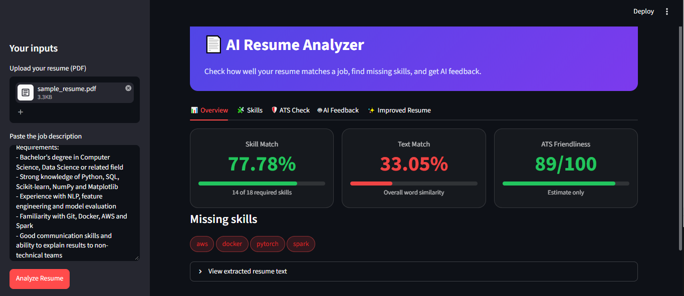

# 📄 AI Resume Analyzer

A web app that compares a resume with a job description, shows which skills are missing, estimates how ATS-friendly the resume is, gives AI feedback, and can generate an improved resume as a PDF.

Built with Python, Streamlit, scikit-learn and an LLM API.

 
  

 


### Improved Resume


## Features

- **Resume parsing**: extracts text from PDF resumes.
- **Skill matching**: finds skills in the resume and the job description, and lists matched, missing and extra skills.
- **Two scores**:
  - *Text Match*: TF-IDF + cosine similarity between resume and job description.
  - *Skill Match*: how many of the skills the job asks for are present in the resume.
- **ATS friendliness check (estimate)**: checks standard sections, email and phone, length, quantified achievements and unreadable characters.
- **AI feedback**: summary review, strengths, weaknesses and bullet point improvements from an LLM.
- **Improved resume generator**: the AI rewrites the resume for the job and the app builds an ATS-friendly PDF, with a before/after score comparison. Only skills that the user confirms are added.

## How it works

```
PDF upload -> text extraction -> text cleaning -> skill extraction
          -> TF-IDF similarity + skill gap analysis -> ATS checks
          -> LLM feedback -> (optional) improved resume PDF
```

Classic NLP produces the numeric scores, which are the same every time. The LLM is used only for feedback and rewriting. If the LLM is unavailable, the rest of the app still works.

## Project structure

```
.
├── app.py              # Streamlit UI
├── extract_text.py     # PDF -> text (pdfplumber)
├── clean_text.py       # text cleaning (regex, lowercase)
├── skills.py           # skill list and keyword matching
├── matcher.py          # TF-IDF + cosine similarity
├── analyzer.py         # matched / missing / extra skills, skill score
├── ats_checker.py      # ATS friendliness checks
├── ai_feedback.py      # LLM calls (feedback)
├── resume_builder.py   # AI rewrite -> structured JSON -> PDF (reportlab)
├── ui_helpers.py       # CSS and HTML helpers for the UI
├── sample_resume.pdf   # fake sample resume for testing
├── job_description.txt # sample job description
└── requirements.txt
```

## Tech stack

| Purpose | Tool |
|---|---|
| UI | Streamlit |
| PDF reading | pdfplumber |
| Similarity | scikit-learn (TF-IDF, cosine similarity) |
| LLM access | OpenRouter API through the `openai` Python library |
| PDF creation | reportlab |

## Setup

**1. Clone the project and create a virtual environment**

```bash
git clone https://github.com/nipun-kumar2020-maker/ai-resume-analyzer.git
cd ai-resume-analyzer
python -m venv venv
venv\Scripts\activate          # Windows
# source venv/bin/activate     # Mac / Linux
```

**2. Install the libraries**

```bash
python -m pip install -r requirements.txt
```

**3. Set your API key**

Get a key from [openrouter.ai](https://openrouter.ai), then set it as an environment variable. Never put the key in the code.

```bash
setx OPENROUTER_API_KEY "your-key-here"        # Windows (restart the terminal afterwards)
# export OPENROUTER_API_KEY="your-key-here"    # Mac / Linux
```

The model is set in `ai_feedback.py` (`MODEL = "..."`). Free models change often, so if you see a "model not found" error, pick a currently available model from [openrouter.ai/models](https://openrouter.ai/models) and update that line.

**4. Run the app**

```bash
streamlit run app.py
```

Streamlit apps must be started with `streamlit run`, not `python app.py`.

## Usage

1. Upload your resume (PDF) in the sidebar.
2. Paste a job description.
3. Click **Analyze Resume** and explore the tabs: Overview, Skills, ATS Check, AI Feedback.
4. In **Improved Resume**, select the missing skills you genuinely have, generate the new resume and download the PDF.

You can try the app with the included `sample_resume.pdf` and `job_description.txt`.

## Limitations

- Scanned (image-only) PDFs are not supported, because there is no OCR.
- Skills are found with a fixed keyword list, so skills outside the list are missed and synonyms (for example "ML" and "machine learning") are treated as different words.
- TF-IDF compares words, not meaning.
- The ATS score is an **estimate**. Every company's ATS works differently.
- LLM output can differ between runs and can contain mistakes. Always read the generated resume carefully before using it.
- Only PDF input is supported.

## Privacy

Resume text is sent to a third-party LLM service (through OpenRouter) to generate feedback and the improved resume. Do not upload documents containing personal data that you do not want to share. Check the data policy of the model you use.

## Future improvements

- OCR for scanned resumes
- DOCX support
- Meaning-based matching with sentence embeddings
- Larger or automatically updated skills database
- Ranking multiple resumes for one job (recruiter mode)
- Removing personal details before sending text to the LLM

## Author

Nipun Kumar
GitHub: nipunkumar2020-maker(https://github.com/nipunkumar2020-maker)
LinkedIn: Nipun Kumar(https://www.linkedin.com/in/nipun-kumar-6827b737a)
